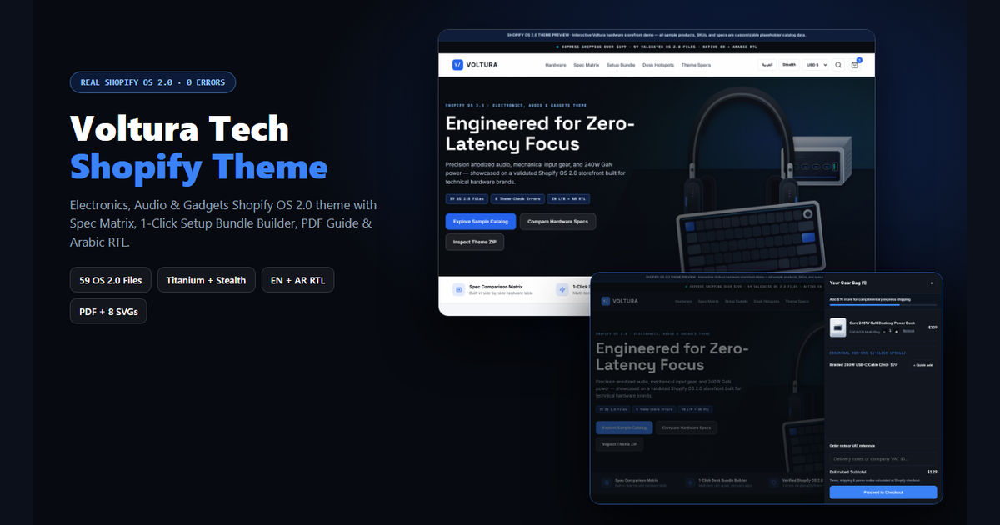

# Shopify OS 2.0 Native Bundle Builder & Cart Upsell Drawer



[](https://shopify.dev/docs/storefronts/themes)
[](#)
[](#)
[](LICENSE)

**Replace $60–$120/month Shopify bundle & cart drawer apps with 2 native Online Store 2.0 Liquid sections and 6.7 KB of zero-dependency vanilla JavaScript (~2.3 KB gzipped).**

Drop straight into **Shopify Dawn** or any **Online Store 2.0** theme — no React runtime, no jQuery, no external iframes, and zero layout shift on mobile.

---

## What's Included (MIT Open Source)

| File | Purpose |
|---|---|
| `sections/bundle-builder.liquid` | Drag-and-drop 1-click multi-item bundle builder using native OS 2.0 `product` blocks + batch `/cart/add.js` POST |
| `sections/cart-drawer.liquid` | Accessible slide-out cart drawer with live free-shipping progress bar, order note, and collection-driven quick-add upsells |
| `assets/bundle-drawer.js` | Single event-delegated vanilla ES6 script (`6.7 KB` uncompressed) syncing `/cart/add.js` & `/cart.js` with XSS-safe DOM rendering |
| `assets/bundle-drawer.css` | Self-contained CSS with custom properties + CSS logical properties (`inset-inline`, `margin-inline`) so LTR & RTL work natively |

---

## 3-Minute Drop-In Installation (Works on Dawn & Any OS 2.0 Theme)

1. Copy these 4 files into your Shopify theme:
   - `sections/bundle-builder.liquid`
   - `sections/cart-drawer.liquid`
   - `assets/bundle-drawer.css`
   - `assets/bundle-drawer.js`
2. Render the Cart Drawer once inside `layout/theme.liquid` (right before `</body>`):
   ```liquid
   
   ```
3. Wire your header cart icon to open the drawer:
   ```html
   <button type="button" data-ck-open="CodeKitCartDrawer">
     Cart (<span data-ck-cart-count>{{ cart.item_count }}</span>)
   </button>
   ```
4. Open **Shopify Admin → Online Store → Customize**, click **Add section → Native Bundle Builder**, pick up to 4 real products from your catalog, and select an **Upsell Collection** inside **Native Cart Drawer**.

### Server-Side Discount Security Note
Client-side JavaScript only displays the live estimated bundle total for instant buyer feedback. Pair `sections/bundle-builder.liquid` with a native **Shopify Automatic Discount** (e.g., *Buy X items / Spend $Y → 15% off*) or **Shopify Functions** inside Shopify Admin so the discount is strictly enforced server-side at checkout — still **$0/month** in app fees.

---

## Want the Complete 59-File Production Shopify OS 2.0 Theme?

These two open-source sections are extracted directly from our production themes at **[CodeKit Studio](https://codekit-studio.pages.dev/)**. If you want to skip 60+ hours of Liquid, schema, responsive QA, and Shopify Theme Check engineering on your next store or client project:

| Feature | Free Starter (This Repo) | [**Voltura**](https://www.codester.com/items/76689/voltura-tech-and-audio-shopify-theme?ref=Ahme3d) *(Tech & Audio — $54)* | [**Qafila**](https://www.codester.com/items/76579/qafila-luxury-bilingual-shopify-os-2-0-theme?ref=Ahme3d) *(Luxury & Fashion — $54)* |
|---|:---:|:---:|:---:|
| Native 1-Click Bundle Builder | ✅ | ✅ | ✅ |
| Slide-Out Cart Drawer + Free Shipping Bar + Upsells | ✅ | ✅ | ✅ |
| Full Validated OS 2.0 Theme (`0` Theme Check Errors) | — | ✅ **59 Files** | ✅ **Full OS 2.0 Kit** |
| Side-by-Side Tech Spec Comparison Matrix | — | ✅ | — |
| Interactive Shop-the-Setup Hotspot Pins | — | ✅ | ✅ |
| Dual Style Presets (Light + Dark / Editorial) | — | ✅ Titanium & Stealth | ✅ Ivory & Obsidian Noir |
| Native English + Arabic RTL Locales (`en` + `ar`) | — | ✅ | ✅ |
| PDF Installation Manual + 8 Editable Brand Banner SVGs | — | ✅ | ✅ |

- **Voltura (Electronics, Audio & Desk Hardware Shopify OS 2.0 Theme):**
  - Live Interactive Demo: [https://voltura-theme.pages.dev/](https://voltura-theme.pages.dev/)
  - Complete Kit on Codester ($54 one-time): [https://www.codester.com/items/76689/voltura-tech-and-audio-shopify-theme?ref=Ahme3d](https://www.codester.com/items/76689/voltura-tech-and-audio-shopify-theme?ref=Ahme3d)
- **Qafila (Luxury, Fragrance & Editorial Shopify OS 2.0 Theme):**
  - Live Interactive Demo: [https://qafila-theme.pages.dev/](https://qafila-theme.pages.dev/)
  - Complete Kit on Codester ($54 one-time): [https://www.codester.com/items/76579/qafila-luxury-bilingual-shopify-os-2-0-theme?ref=Ahme3d](https://www.codester.com/items/76579/qafila-luxury-bilingual-shopify-os-2-0-theme?ref=Ahme3d)
- **More from CodeKit Studio:** [Saffra WooCommerce 9.x FSE Block Theme](https://saffra-theme.pages.dev/) · [BillCraft Browser-Local Next.js 15 Invoice Studio](https://billcraft-app.pages.dev/)

---

## License

MIT © [CodeKit Studio](https://codekit-studio.pages.dev/). Star this repo if it saved you a $90/mo Shopify app bill!
